# ELEVATE-SDE-Task-2 · CredVault (Frontend)

CredVault is a certificate issuing and verification platform. This task covers the **frontend only**, built with plain HTML, CSS and JavaScript and **dummy data** (no backend or database).

Citizens can request a certificate, track an application and verify a certificate. Admins can log in, issue or reject applications and revoke certificates.

## Run it

No install or build step.

- Open `index.html` in a browser, or
- Serve the folder: `python -m http.server 8000` and visit `http://localhost:8000`

## Pages

| Route | File | What it does |
|---|---|---|
| `/` | `index.html` | Title, tagline, three navigation buttons |
| `/request` | `request/index.html` | Request form with validation, shows success message and Application ID |
| `/track` | `track/index.html` | Look up an application by ID (Pending / Approved / Rejected) |
| `/verify` | `verify/index.html` | Look up a certificate by ID (Valid / Revoked / Not Found) |
| `/admin/login` | `admin/login/index.html` | Admin login (`admin` / `admin`) |
| `/admin/applications` | `admin/applications/index.html` | Table with Issue and Reject actions |
| `/admin/certificates` | `admin/certificates/index.html` | Table with Revoke action |

## Demo data

- Applications: `APP-0001` (Approved), `APP-0002` (Pending), `APP-0004` (Rejected)
- Certificates: `CERT-1001` (Valid), `CERT-1003` (Revoked)
- Admin login: username `admin`, password `admin`

Data is kept in the browser's `localStorage` so the pages share state (a new request appears in the admin table, issuing creates a certificate you can verify). Use **Reset demo data** on the Applications page to start over.

## Project structure

```
index.html
request/ track/ verify/        public pages
admin/login/ applications/ certificates/
assets/style.css               shared styles (light and dark mode)
assets/app.js                  dummy data store, header, helpers
screenshots/                   images used below
```

## Ready for the backend (Task 3)

All data access goes through the `CV` object in `assets/app.js` (`apps()`, `certs()`, `addApp()`, `issue()`, `reject()`, `revoke()`, `login()`). Replace those with API calls and the pages stay unchanged.

## Screenshots

### Home
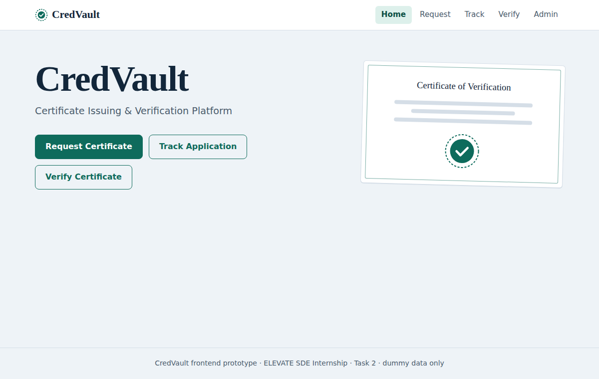

### Request Certificate
Validation for empty fields:
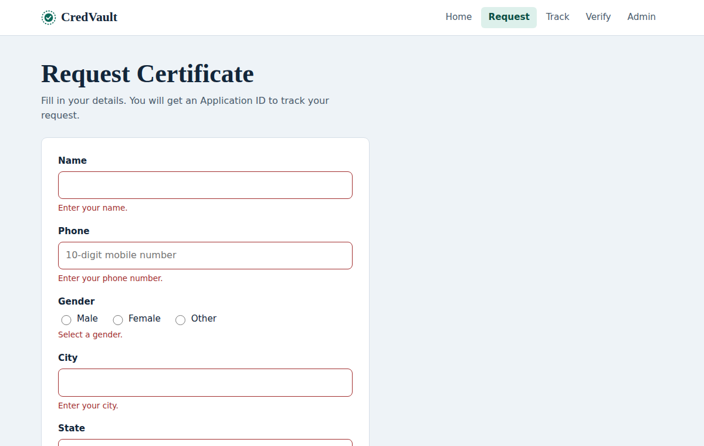

Success message with Application ID:
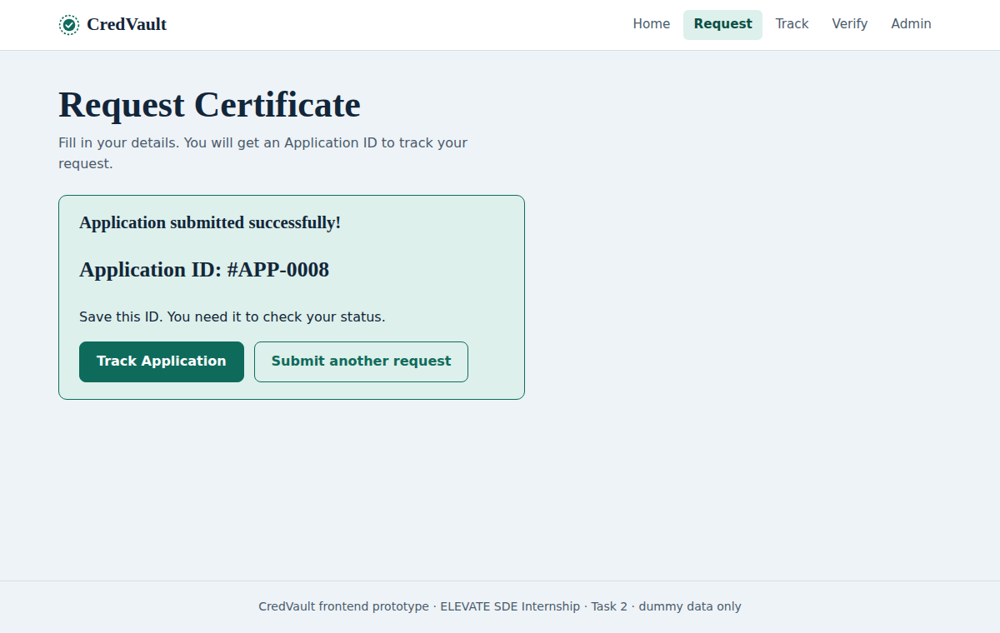

### Track Application
Found:
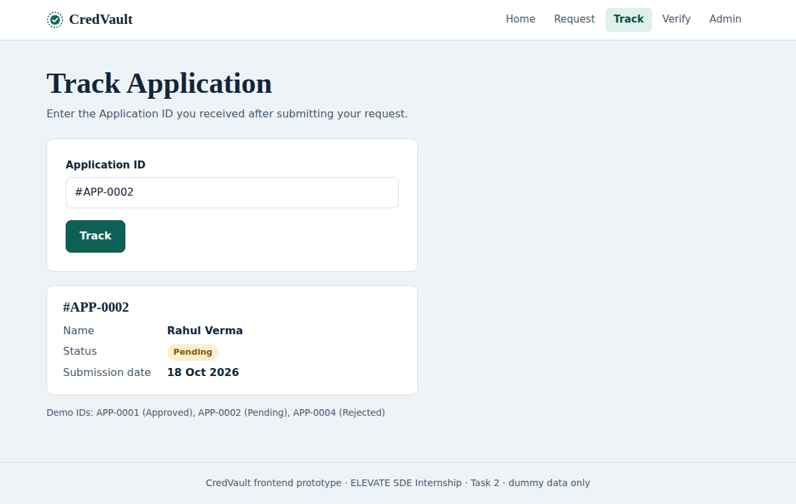

Not found:
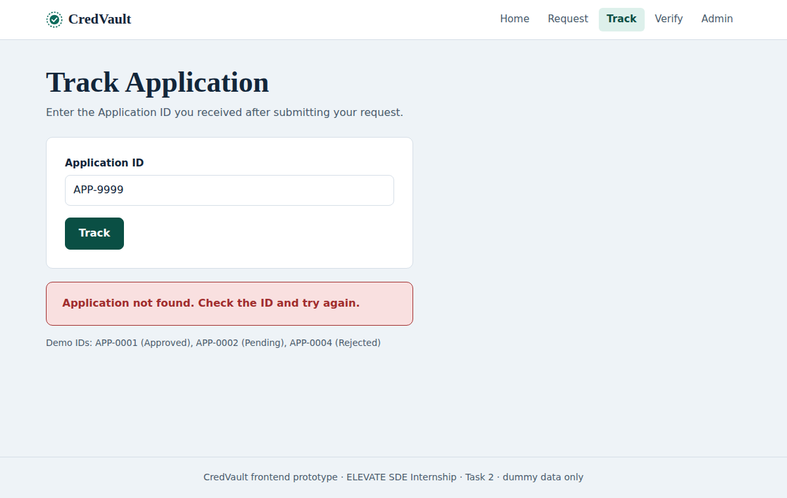

### Verify Certificate
Valid:
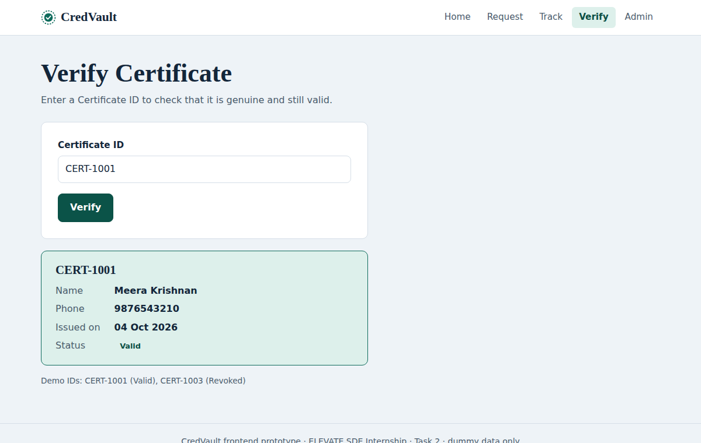

Revoked:
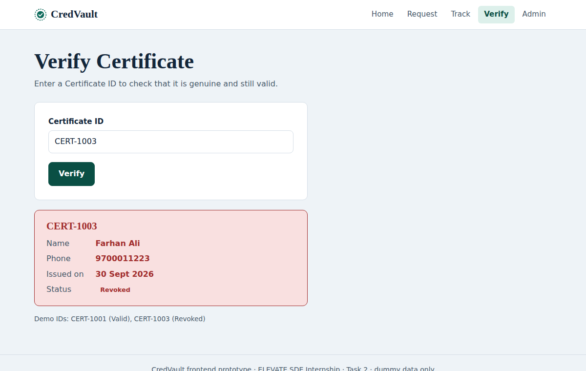

Not found:
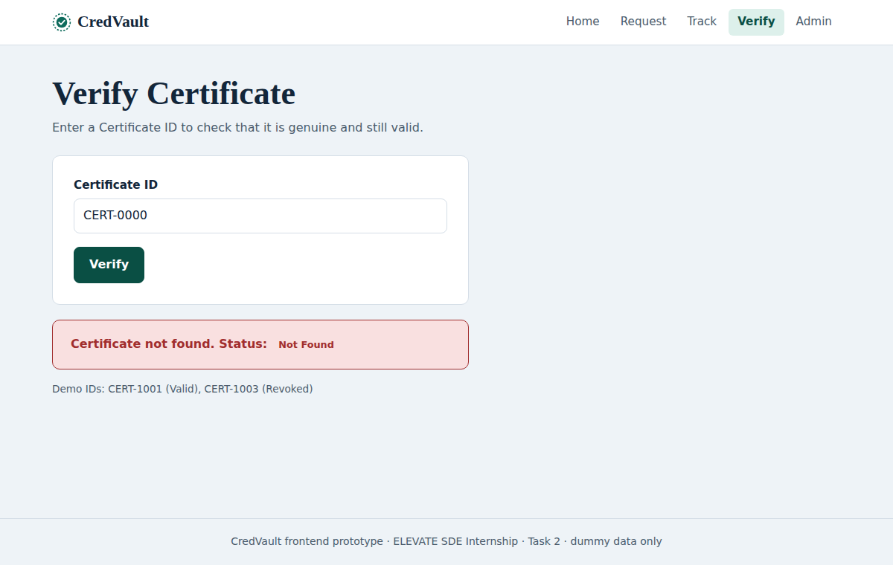

### Admin Login
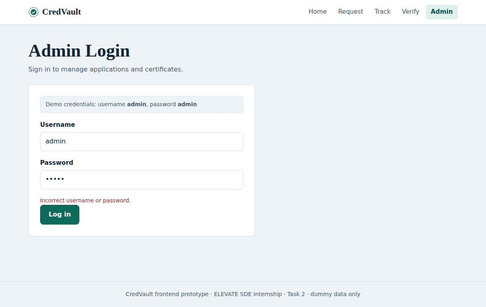

### Admin Applications
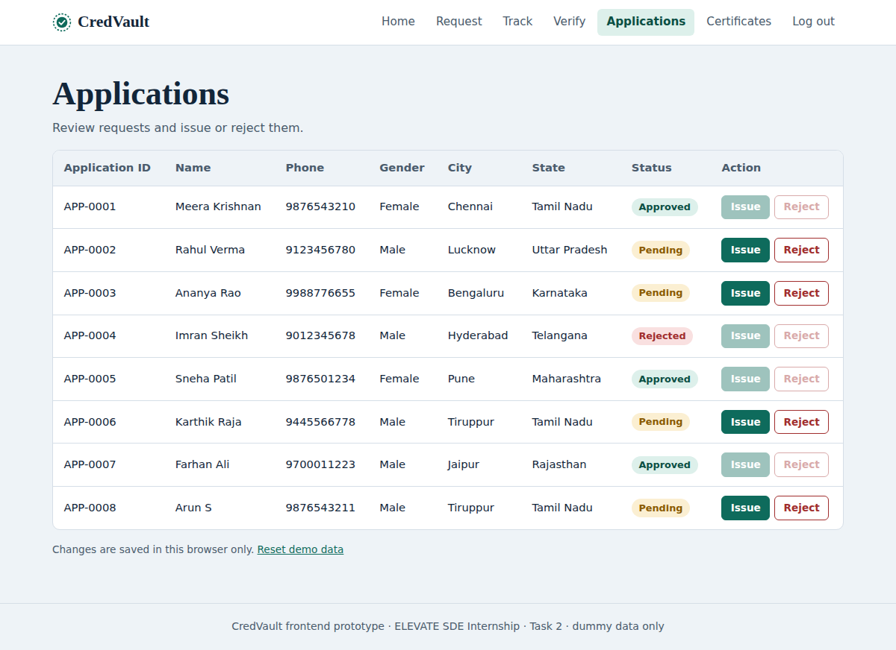

After issuing and rejecting:
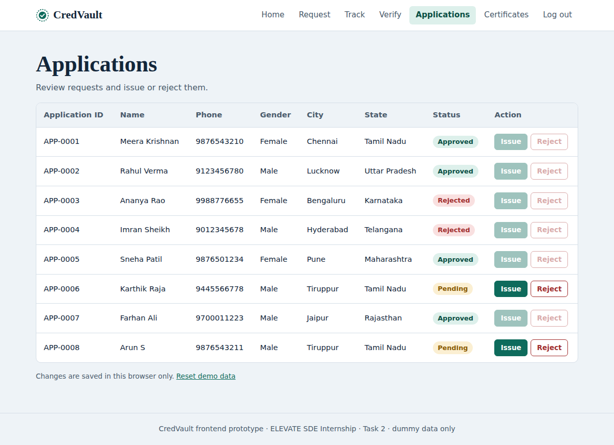

### Admin Certificates
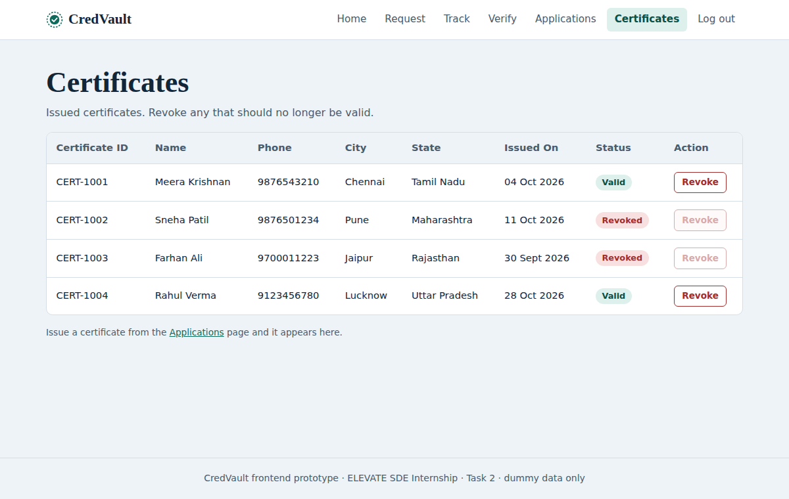
